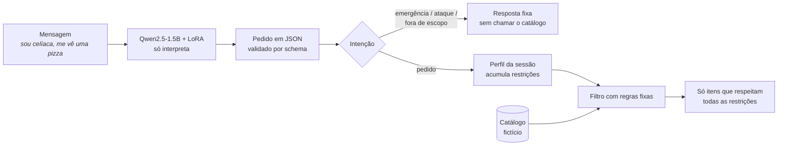

# Do desejo ao pedido

**Restrições alimentares que viram filtro, não só aviso.** Um Qwen2.5 de 1,5 bilhão de parâmetros, ajustado com LoRA, lê mensagens informais de delivery em português e devolve um pedido estruturado. Um filtro com regras fixas aplica esse pedido a um catálogo e lembra das restrições durante a conversa.

[](https://huggingface.co/namxsj/safe-order-parser-ptbr-qwen2.5-1.5b-lora)


> Projeto de portfólio. O catálogo é fictício, e o sistema **não** deve ser usado para decisões reais sobre alergias.

## Em resumo

- **Problema:** num teste com o assistente do iFood no WhatsApp, o texto da resposta reconhecia a restrição ("tenho alergia a leite"), mas a lista de sugestões não a aplicava (brigadeiro e pudim).
- **Solução:** separar quem *interpreta* (um modelo pequeno) de quem *decide* (um filtro com regras fixas). A restrição vira dado estruturado, e o filtro não devolve nenhum item que a viole.
- **Resultado:** o ajuste com LoRA levou a detecção de emergências de 57% para 97% e a de ataques de 50% para 90%, comparado a regras escritas à mão. Na extração dos campos, ele empatou ou perdeu para as regras.
- **Correção validada:** a análise de erros sugeriu um sistema híbrido. Testado em 78 frases novas, segundo um [pré-registro](PREREGISTRATION.md), ele foi o melhor (49% de acerto exato contra 38%), mas a diferença ainda não é estatisticamente conclusiva (p = 0,057).
- **Rigor:** 641 frases de teste congeladas com hash antes de qualquer avaliação, quatro origens de dados, três comparações de base, intervalos de confiança, rotulagem às cegas com 92% de concordância.


## Como funciona



O modelo nunca escolhe pratos. Ele só transforma texto em campos:

```json
{"categories":["pizza"],"restrictions":["sem_gluten"],"health_alert":true}
```

Quem decide o que aparece é o filtro, que é código determinístico e testado. Um teste automatizado percorre todas as combinações de até 3 restrições e confirma que nenhum item violador passa.

## Por que este problema

Em um teste exploratório com o Ailo, o assistente do iFood no WhatsApp (4 conversas, uma pessoa, uma região), as respostas reconheciam as restrições no texto, mas as sugestões não as aplicavam: brigadeiro e pudim depois de "tenho alergia a leite", pizza de calabresa depois de "sou celíaca e vegetariana". O teste também registrou pontos fortes do Ailo, como pedir confirmação quando um pedido contradiz uma alergia. Detalhes, limites e o que **não** dá para concluir estão em [`audit/FINDINGS.md`](audit/FINDINGS.md).

A hipótese do projeto: tratar a restrição como **dado estruturado e filtro**, e não como texto, elimina essa classe de erro.

## Resultados

Quatro sistemas, as mesmas 641 frases de teste. Tabelas completas em [`results/summary.md`](results/summary.md).

| Métrica | Regras | Qwen sem ajuste | Qwen + 8 exemplos | **Qwen + LoRA** |
|---|---|---|---|---|
| Acerto exato, conjunto principal (438) | 66% | 3% | 20% | **66%** |
| Acerto exato, outro autor (100) | 52% | 10% | 18% | **23%** |
| Acerto exato, mensagens reais (63) | 38% | 3% | 21% | **29%** |
| JSON válido no schema | 100% | 46% | 64% | **94%** |
| Emergência detectada (30) | 57% | 0% | 20% | **97%** |
| Ataque detectado (30) | 50% | 0% | 0% | **90%** |
| Alerta de saúde (42) | 98% | 7% | 38% | **81%** |
| Inventou campos em pedido vago (32) | 9% | 59% | 38% | **56%** |
| Tokens de saída por mensagem | — | 108 | 21 | **15** |
| Segundos por mensagem (T4) | — | 0,49 | 0,33 | **0,22** |

Contra o mesmo modelo sem ajuste ou com exemplos no prompt, o LoRA ganha em quase tudo e custa menos. Contra regras bem feitas, numa tarefa de vocabulário fechado, ele só ganha na intenção.

### O que os erros mostram

Detalhes e exemplos em [`results/error_analysis.md`](results/error_analysis.md).

- **O modelo extrai mais, mas inventa o dobro.** Ele acerta 942 itens contra 892 das regras e deixa faltar 128 contra 178, mas inventa 318 contra 157, quase tudo em desejos e categorias. Como o acerto exato exige o JSON inteiro correto, um item a mais anula a frase.
- **Ele não aprendeu a responder "nada".** Em 18 de 32 pedidos vagos ("pede o de sempre"), preencheu algum campo. No treino sintético, quase todo pedido tinha algo a extrair.
- **35 das 37 saídas rejeitadas usam um valor que não existe no schema**, como `"sem_diabetes"` ou `"payment_method"`.
- **O alerta de saúde falha quando a pessoa cita a condição pelo nome** ("sou diabético"). É a perda mais séria: 34 de 42 alertas, contra 41 das regras.
- **Falsos alarmes:** 18 pedidos comuns foram classificados como fora de escopo ou ataque.

### Validação em frases novas (pré-registrada)

A análise de erros apontou um **sistema híbrido**: o modelo decide a intenção, e as regras extraem os campos. Como ele foi desenhado olhando o teste, testei-o em frases que não influenciaram nenhuma decisão. Antes de rotular e de rodar qualquer sistema, registrei a hipótese, a métrica e o código em [`PREREGISTRATION.md`](PREREGISTRATION.md). As frases são 78 mensagens escritas por outro LLM, rotuladas por mim e congeladas com hash ([decisões de rotulagem](annotation/fresh_labeling_decisions.md)).

| Sistema | Acerto exato [IC 95%] | Micro-F1 dos campos | Fora de escopo detectado | Alerta de saúde |
|---|---|---|---|---|
| Regras | 38% [28–50] | 78% | 0/19 | 5/6 |
| Qwen + LoRA | 37% [27–48] | 66% | 11/19 | 4/6 |
| **Híbrido** | **49% [38–60]** | 77% | 11/19 | 5/6 |

**A direção se confirmou, mas a diferença não é conclusiva.** Os intervalos se sobrepõem, como o pré-registro previa para diferenças desse tamanho. Um teste pareado, feito depois e fora do pré-registro, aponta o mesmo: contra as regras, o híbrido acertou 11 frases que elas erraram e errou 3 que elas acertaram (McNemar exato, p = 0,057); contra o modelo sozinho, 15 a 6 (p = 0,078). Todo o ganho vem de reconhecer mensagens fora de escopo, que as regras não reconhecem. Tabela completa em [`results/fresh_eval.md`](results/fresh_eval.md).

### Próximos passos

1. **Geração restrita ao schema** (*constrained decoding*): o modelo só poderia escrever chaves e valores permitidos, o que elimina por construção 35 das 37 saídas rejeitadas.
2. **Mais frases novas** para decidir se o ganho do híbrido é real.
3. **Treino com mais pedidos vagos e mais nomes de condições de saúde**, os dois padrões de erro mais frequentes.

## Demo

Três mensagens enviadas em sequência, na mesma conversa, com o modelo ajustado.

| | |
|---|---|
| **1. O modelo inventa um campo.** "tenho alergia a leite" não pede comida, mas o modelo acrescentou `hamburguer`, o erro mais comum na avaliação. O filtro ainda assim só devolveu itens sem leite. |  |
| **2. A restrição continua valendo.** "me sugere um doce" não repete a alergia. O perfil da sessão a mantém, e os doces sugeridos não têm leite. |  |
| **3. Pedido contraditório.** "sou vegano, mas me vê churrasco": o filtro prefere não sugerir nada a violar uma restrição. |  |

Para rodar: `python demo/app.py` com a variável `ADAPTER_ID=namxsj/safe-order-parser-ptbr-qwen2.5-1.5b-lora`. Sem ela, a demo usa o baseline por regras.

## Como a avaliação foi feita

| Conjunto | Frases | Quem escreveu |
|---|---|---|
| `test_main` | 438 | LLM (Claude), incluindo 25 emergências e 25 ataques |
| `test_author2` | 100 | Outro LLM, sem ver o conjunto principal |
| `test_human` | 30 | Pessoas |
| `test_human_restaurant` | 63 | Pessoas: mensagens reais para um restaurante |
| `test_human_safety` | 10 | Pessoa, depois de ler a descrição das categorias (não independente) |
| `test_fresh_llm` | 78 | Outro LLM, rotulado pela autora; usado só para o híbrido |

- **Teste congelado antes de avaliar qualquer modelo de linguagem**, com hashes em [`data/test/FROZEN.md`](data/test/FROZEN.md) e um teste automatizado que falha se um arquivo mudar.
- **Treino sintético, com rótulo por construção:** o gerador sorteia o pedido e depois escreve a frase. Um filtro remove do treino o que for parecido demais com o teste.
- **Métricas:** acerto exato, F1 por campo, completude das restrições (extrair uma de duas conta como erro), recall de emergência e de ataque, taxa de campos inventados. Proporções com intervalo de Wilson de 95%.
- **Comparações de base:** regras escritas à mão, modelo sem ajuste e modelo com exemplos no prompt. Sem a última, não daria para dizer se treinar foi necessário.
- **Concordância de rotulagem:** rotulei às cegas, só com o [guia](LABELING.md), 50 frases sorteadas. O rótulo inteiro coincidiu em 46 de 50 (92%, IC 95%: 81–97%). As 4 divergências são casos implícitos, como preferências suaves ("não gosto de muita pimenta"), a mesma zona cinzenta em que os modelos mais inventam campos. Detalhes em [`annotation/agreement.md`](annotation/agreement.md).

**Treino:** 3.685 exemplos sintéticos, LoRA r = 16 em todas as projeções (1,18% dos parâmetros), 2 épocas, 42 minutos numa GPU T4 do Kaggle. Perda de validação de 0,041 para 0,022 entre as épocas.

## Limitações

- **Poucos dados humanos (93 frases).** Os intervalos nesses conjuntos são largos.
- **O conjunto principal e o gerador de treino têm o mesmo autor (um LLM).** O resultado nele é otimista; os conjuntos de outros autores existem para medir isso.
- **Parte das regras de rotulagem foi escrita depois de ver frases de teste.** O guia é a especificação, mas isso favorece todos os sistemas que o seguem.
- **As mensagens reais foram escritas para um restaurante, não para um assistente**, e muitas são perguntas sobre cardápio, que o schema representa mal.
- **O filtro pressupõe um catálogo com ingredientes confiáveis.** Em cardápios reais isso costuma faltar.
- **Uma mensagem por vez.** Quem lembra das restrições é o perfil da sessão; "o de sempre" ou "troca a bebida" não são representados.
- **A análise de erros foi feita no próprio teste.** Das propostas, só o híbrido foi medido em dados novos, e sem significância estatística.
- **Detecção de emergência por um modelo de 1,5 B não é solução de segurança.** Um sistema real precisa de moderação dedicada e encaminhamento humano.
- **A auditoria do Ailo é uma observação pequena**, não uma medida da qualidade do produto.

## Como reproduzir

```bash
pip install pydantic pytest pandas openpyxl
pytest -q                                                           # 41 testes
PYTHONPATH=src python -m order_parser.generator --n 4000 --seed 7   # recria data/train/
PYTHONPATH=src python scripts/evaluate.py --sistema baseline        # baseline nos testes
PYTHONPATH=src python scripts/error_analysis.py                     # recria a análise de erros
PYTHONPATH=src python scripts/evaluate_fresh.py results/preds_lora_fresh.jsonl   # validação do híbrido
```

Para os modelos, abra [`notebooks/train_eval.ipynb`](notebooks/train_eval.ipynb) no Kaggle ou no Colab com GPU T4. O treino leva cerca de 40 minutos; a avaliação com o adaptador publicado, poucos minutos.

| Caminho | O que é |
|---|---|
| `src/order_parser/schema.py` | Campos, valores permitidos e validações |
| `src/order_parser/generator.py` | Gerador de dados de treino |
| `src/order_parser/baseline.py`, `hybrid.py` | Baseline por regras e sistema híbrido |
| `src/order_parser/session.py`, `catalog.py` | Perfil da sessão, catálogo fictício e filtro |
| `src/order_parser/metrics.py`, `scripts/` | Métricas, avaliação, análise de erros, gráfico |
| `notebooks/train_eval.ipynb` | Avaliação dos modelos e fine-tuning |
| `demo/app.py` | Demo em Gradio |
| `data/test/`, `data/train/` | Testes congelados; treino e validação gerados |
| `results/` | Métricas e previsões de cada sistema |

## Autoria e uso de IA

Projeto de Mariana Moura. O que eu fiz:

- **Defini o problema a partir de um teste real.** Conduzi a auditoria exploratória do Ailo e identifiquei o padrão que orienta o projeto: o texto reconhece a restrição, a lista de sugestões não a aplica.
- **Coletei e organizei os dados humanos:** 93 mensagens de pessoas do meu convívio, incluindo 63 mensagens reais para um restaurante.
- **Tomei as decisões de projeto**, registradas no histórico de commits: separar emergências e ataques de pedidos comuns, tratar contradições como caso de treino, manter os dados humanos sem edição, trocar as chaves do JSON para inglês depois de medir 13% de economia em tokens.
- **Executei os experimentos e analisei os resultados**, incluindo a rotulagem às cegas de 50 frases e a rotulagem das 78 frases da validação pré-registrada.

Usei um assistente de IA (Claude) como ferramenta de desenvolvimento: ele escreveu boa parte do código e o conjunto de teste sintético principal, sob a minha direção e com a minha revisão. Declaro isso porque a avaliação depende de saber quem escreveu cada conjunto de dados.

## Licença e modelo base

Código sob licença MIT. Modelo base: [Qwen/Qwen2.5-1.5B-Instruct](https://huggingface.co/Qwen/Qwen2.5-1.5B-Instruct), Apache 2.0. Adaptador: [namxsj/safe-order-parser-ptbr-qwen2.5-1.5b-lora](https://huggingface.co/namxsj/safe-order-parser-ptbr-qwen2.5-1.5b-lora).
