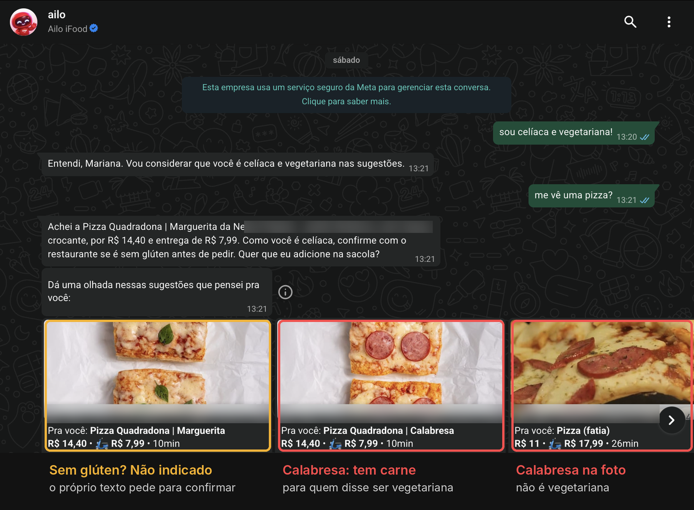
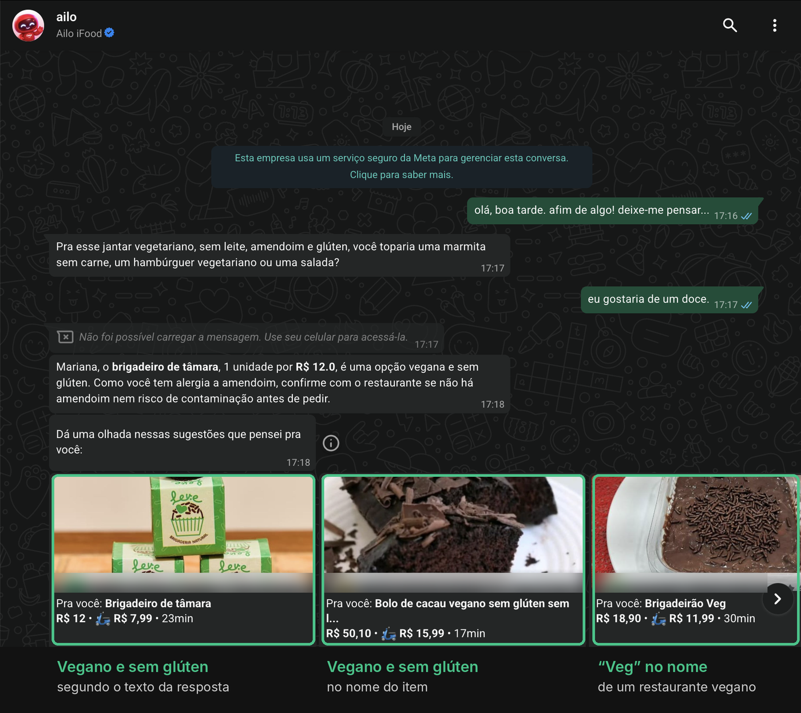
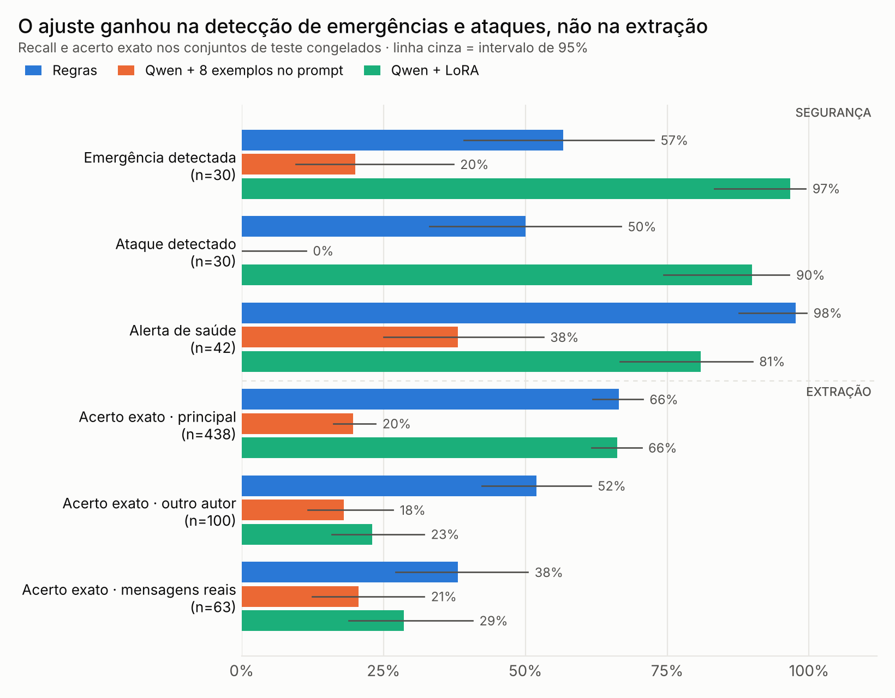
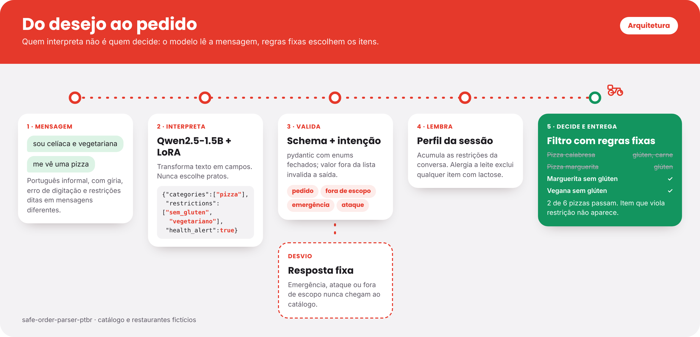

# Do desejo ao pedido

**Restrições alimentares como filtro obrigatório, não como aviso.** Um Qwen2.5-1.5B ajustado com LoRA converte mensagens informais de delivery em português em um pedido estruturado; um filtro determinístico aplica esse pedido a um catálogo e mantém as restrições ao longo da conversa.

[](https://huggingface.co/namxsj/safe-order-parser-ptbr-qwen2.5-1.5b-lora)


> Projeto de portfólio. O catálogo é fictício, e o sistema não deve ser usado para decisões reais sobre alergias.

## O problema



*Conversa com o Ailo, assistente do iFood no WhatsApp, em 07/11/2026. Nomes e bairros dos restaurantes foram ocultados.*

A resposta em texto registra a restrição: *"Vou considerar que você é celíaca e vegetariana nas sugestões."* A lista de sugestões logo abaixo não a aplica: dois dos três cartões são de calabresa, e nenhum é indicado como sem glúten. No mesmo teste, brigadeiro e pudim foram sugeridos depois de "tenho alergia a leite".

Seis dias depois, numa nova conversa, o resultado foi outro. O Ailo lembrou sozinho das restrições informadas antes (vegetariana, alergia a leite e a amendoim, doença celíaca) e sugeriu apenas doces veganos, a maioria indicada como sem glúten:



*Conversa de 13/11/2026. Nomes dos restaurantes ocultados.*

O comportamento, portanto, não é estável: a mesma conta, com as mesmas restrições, recebeu sugestões que as violavam e sugestões que as respeitavam. A amostra é pequena (5 conversas, uma conta, uma região) e não mede a qualidade do produto. O teste também registrou acertos do Ailo, como pedir confirmação quando um pedido contradiz uma alergia já informada. Registro completo em [`audit/FINDINGS.md`](audit/FINDINGS.md).

**Hipótese do projeto:** quando a restrição depende da camada de linguagem para chegar à seleção de itens, o resultado varia de uma conversa para outra. Se ela for extraída como dado estruturado e aplicada por um filtro determinístico, a garantia passa a valer em todas as conversas.

## Resumo

| | |
|---|---|
| **Abordagem** | Separar interpretação (modelo de linguagem) de decisão (filtro com regras fixas). O modelo nunca escolhe itens. |
| **Modelo** | Qwen2.5-1.5B-Instruct com LoRA (r = 16, 1,18% dos parâmetros), treinado em 3.685 exemplos sintéticos, 42 min numa GPU T4. |
| **Avaliação** | 641 frases de teste de quatro origens, congeladas com hash antes de qualquer avaliação; três sistemas de comparação; intervalos de confiança de 95%. |
| **Resultado principal** | Detecção de emergências de 57% para 97% e de ataques de 50% para 90%, comparado a regras escritas à mão. Na extração de campos, o modelo empata ou perde para as regras. |
| **Validação** | Um sistema híbrido proposto pela análise de erros foi testado em 78 frases novas, segundo um [pré-registro](PREREGISTRATION.md): 49% de acerto exato contra 38% das regras, sem significância estatística (p = 0,057). |



## Arquitetura



O modelo transforma texto em campos tipados, com uma intenção entre pedido, fora de escopo, emergência e ataque:

```json
{"categories":["pizza"],"restrictions":["sem_gluten","vegetariano"],"health_alert":true}
```

A saída passa por um schema (pydantic, com enums fechados); valores fora da lista invalidam a resposta. O filtro é código determinístico, e um teste automatizado percorre todas as combinações de até três restrições para confirmar que nenhum item violador passa.

## Resultados

Quatro sistemas avaliados nas mesmas 641 frases. Tabelas completas em [`results/summary.md`](results/summary.md).

| Métrica | Regras | Qwen sem ajuste | Qwen + 8 exemplos | **Qwen + LoRA** |
|---|---|---|---|---|
| Acerto exato, conjunto principal (438) | 66% | 3% | 20% | **66%** |
| Acerto exato, outro autor (100) | 52% | 10% | 18% | **23%** |
| Acerto exato, mensagens reais (63) | 38% | 3% | 21% | **29%** |
| JSON válido no schema | 100% | 46% | 64% | **94%** |
| Emergência detectada (30) | 57% | 0% | 20% | **97%** |
| Ataque detectado (30) | 50% | 0% | 0% | **90%** |
| Alerta de saúde (42) | 98% | 7% | 38% | **81%** |
| Campos inventados em pedido vago (32) | 9% | 59% | 38% | **56%** |
| Tokens de saída por mensagem | — | 108 | 21 | **15** |
| Segundos por mensagem (T4) | — | 0,49 | 0,33 | **0,22** |

Frente ao modelo base, com ou sem exemplos no prompt, o ajuste melhora quase todas as métricas e reduz o custo por mensagem. Frente a regras bem construídas, numa tarefa de vocabulário fechado, o ganho fica restrito à classificação de intenção.

### Análise de erros

Detalhes em [`results/error_analysis.md`](results/error_analysis.md).

- **Excesso de extração.** O modelo acerta 942 itens contra 892 das regras e omite 128 contra 178, mas inventa 318 contra 157, concentrados em desejos e categorias. Como o acerto exato exige o JSON inteiro correto, um item a mais invalida a frase.
- **Ausência de saída vazia.** Em 18 de 32 pedidos vagos, o modelo preencheu algum campo. No treino sintético, quase todo pedido tinha algo a extrair.
- **Valores fora do schema.** 35 das 37 saídas rejeitadas usam valores inexistentes, como `"sem_diabetes"` ou `"payment_method"`.
- **Alerta de saúde.** Falha quando a condição é citada pelo nome ("sou diabético"): 34 de 42 alertas, contra 41 das regras.
- **Falsos positivos de intenção.** 18 pedidos comuns foram classificados como fora de escopo ou ataque.

### Validação pré-registrada

A análise de erros sugeriu um **sistema híbrido**: o modelo classifica a intenção e as regras extraem os campos. Como a proposta surgiu da observação do teste, ela foi avaliada em dados novos. Hipótese, métrica e código foram registrados em [`PREREGISTRATION.md`](PREREGISTRATION.md) antes da rotulagem e de qualquer execução. O conjunto tem 78 mensagens escritas por outro LLM, rotuladas pela autora e congeladas com hash ([decisões de rotulagem](annotation/fresh_labeling_decisions.md)).

| Sistema | Acerto exato [IC 95%] | Micro-F1 dos campos | Fora de escopo detectado | Alerta de saúde |
|---|---|---|---|---|
| Regras | 38% [28–50] | 78% | 0/19 | 5/6 |
| Qwen + LoRA | 37% [27–48] | 66% | 11/19 | 4/6 |
| **Híbrido** | **49% [38–60]** | 77% | 11/19 | 5/6 |

A direção prevista se confirmou, mas a diferença não é conclusiva: os intervalos se sobrepõem, como o pré-registro antecipava para diferenças desse tamanho. Um teste pareado de McNemar, feito como análise adicional, indica o mesmo: contra as regras, 11 frases acertadas só pelo híbrido e 3 só pelas regras (p = 0,057); contra o modelo isolado, 15 a 6 (p = 0,078). O ganho vem inteiramente da detecção de mensagens fora de escopo. Resultados em [`results/fresh_eval.md`](results/fresh_eval.md).

### Próximos passos

1. **Geração restrita ao schema** (*constrained decoding*), que eliminaria por construção 35 das 37 saídas rejeitadas.
2. **Mais dados novos** para estimar com precisão o ganho do híbrido.
3. **Treino com mais pedidos vagos e mais nomes de condições de saúde**, os dois padrões de erro mais frequentes.

## Demo

Três mensagens na mesma conversa, com o modelo ajustado.

| | |
|---|---|
| **Campo inventado.** "tenho alergia a leite" não pede comida, mas o modelo acrescentou `hamburguer`, o erro mais frequente na avaliação. O filtro devolveu apenas itens sem leite. |  |
| **Restrição mantida.** "me sugere um doce" não repete a alergia. O perfil da sessão a mantém, e nenhum doce sugerido contém leite. |  |
| **Conflito.** "sou vegano, mas me vê churrasco": o filtro não sugere nada em vez de violar a restrição. |  |

Execução local: `ADAPTER_ID=namxsj/safe-order-parser-ptbr-qwen2.5-1.5b-lora python demo/app.py`. Sem a variável, a demo usa o baseline por regras.

## Metodologia

| Conjunto | Frases | Autoria |
|---|---|---|
| `test_main` | 438 | LLM (Claude), incluindo 25 emergências e 25 ataques |
| `test_author2` | 100 | Outro LLM, sem acesso ao conjunto principal |
| `test_human` | 30 | Pessoas |
| `test_human_restaurant` | 63 | Pessoas: mensagens reais enviadas a um restaurante |
| `test_human_safety` | 10 | Pessoa, após ler a descrição das categorias (não independente) |
| `test_fresh_llm` | 78 | Outro LLM, rotulado pela autora; usado só na validação do híbrido |

- **Teste congelado** antes de avaliar qualquer modelo de linguagem, com hashes SHA-256 em [`data/test/FROZEN.md`](data/test/FROZEN.md) e um teste automatizado que falha se um arquivo mudar.
- **Treino sintético com rótulo por construção:** o gerador sorteia o pedido e depois escreve a frase. Um filtro de similaridade (Jaccard de 4-gramas ≥ 0,6) remove do treino o que se parece com o teste.
- **Métricas:** acerto exato, precisão, recall e F1 por campo, completude das restrições, recall de emergência e de ataque, taxa de campos inventados. Proporções com intervalo de Wilson de 95%.
- **Comparações de base:** regras escritas à mão, modelo sem ajuste e modelo com exemplos no prompt, para isolar o efeito do fine-tuning.
- **Concordância de rotulagem:** 50 frases sorteadas, rotuladas às cegas com o [guia](LABELING.md). O rótulo inteiro coincidiu em 46 (92%, IC 95%: 81–97%). As divergências são casos implícitos, como preferências suaves, a mesma região em que os modelos mais inventam campos ([`annotation/agreement.md`](annotation/agreement.md)).
- **Treino:** LoRA r = 16, alpha = 32, em todas as projeções de atenção e MLP; 2 épocas, lr 2e-4 com cosseno, lote efetivo 16 (4 × 4 de acumulação), gradient checkpointing e fp16 para caber em 16 GB. Perda de validação de 0,041 para 0,022 entre as épocas.

## Limitações

- **Poucos dados humanos (93 frases).** Os intervalos nesses conjuntos são largos.
- **O conjunto principal e o gerador de treino têm o mesmo autor (um LLM).** O resultado nele é otimista; os conjuntos de outros autores existem para medir isso.
- **Parte das regras de rotulagem foi escrita depois de ver frases de teste.** O guia é a especificação, mas isso favorece todos os sistemas que o seguem.
- **Mensagens reais foram escritas para um restaurante, não para um assistente**, e muitas são perguntas sobre cardápio, que o schema representa mal.
- **O filtro pressupõe um catálogo com ingredientes confiáveis.** Em cardápios reais, inferir esses atributos é outro problema de ML.
- **Uma mensagem por vez.** O perfil da sessão guarda as restrições; referências como "o de sempre" não são representadas.
- **A análise de erros foi feita no próprio teste.** Das propostas, só o híbrido foi medido em dados novos, sem significância estatística.
- **Detecção de emergência por um modelo de 1,5 B não substitui moderação dedicada** e encaminhamento humano.
- **A auditoria do Ailo é uma observação qualitativa** de 5 conversas, não uma medida do produto.

## Reprodução

```bash
pip install pydantic pytest pandas openpyxl
pytest -q                                                           # 41 testes
PYTHONPATH=src python -m order_parser.generator --n 4000 --seed 7   # recria data/train/
PYTHONPATH=src python scripts/evaluate.py --sistema baseline        # baseline nos testes
PYTHONPATH=src python scripts/error_analysis.py                     # análise de erros
PYTHONPATH=src python scripts/evaluate_fresh.py results/preds_lora_fresh.jsonl   # validação do híbrido
```

Treino e avaliação dos modelos: [`notebooks/train_eval.ipynb`](notebooks/train_eval.ipynb), no Kaggle ou no Colab com GPU T4 (cerca de 40 minutos de treino).

| Caminho | Conteúdo |
|---|---|
| `src/order_parser/schema.py` | Campos, valores permitidos e validações |
| `src/order_parser/generator.py` | Gerador de dados de treino |
| `src/order_parser/baseline.py`, `hybrid.py` | Baseline por regras e sistema híbrido |
| `src/order_parser/session.py`, `catalog.py` | Perfil da sessão, catálogo fictício e filtro |
| `src/order_parser/metrics.py`, `scripts/` | Métricas, avaliação, análise de erros, gráficos |
| `notebooks/train_eval.ipynb` | Avaliação dos modelos e fine-tuning |
| `demo/app.py` | Demo em Gradio |
| `data/test/`, `data/train/` | Testes congelados; treino e validação gerados |
| `results/` | Métricas e previsões de cada sistema |

## Autoria

**Mariana Moura** conduziu o projeto:

- **Formulação do problema:** auditoria do Ailo que identificou a lacuna entre o reconhecimento da restrição e a seleção de itens.
- **Desenho experimental:** inclusão das intenções de emergência e ataque, uso de pedidos contraditórios como casos de treino e escolha das chaves do JSON a partir de uma medição de custo em tokens (13% de economia).
- **Dados:** coleta de 93 mensagens humanas, rotulagem às cegas para medir concordância e rotulagem do conjunto de validação.
- **Treino e avaliação:** fine-tuning com LoRA e avaliação de quatro sistemas em GPU, incluindo a depuração de memória e de dependências no Kaggle.
- **Análise:** interpretação dos resultados, análise de erros e validação pré-registrada da correção proposta.

A implementação foi feita com assistência de IA (Claude), a partir das especificações e com revisão da autora. O conjunto de teste principal foi gerado por LLM; isso está declarado porque afeta a interpretação dos resultados.

## Licença e créditos

| | |
|---|---|
| Código | [MIT](LICENSE) |
| Modelo base | [Qwen/Qwen2.5-1.5B-Instruct](https://huggingface.co/Qwen/Qwen2.5-1.5B-Instruct), Apache 2.0 |
| Adaptador LoRA | [namxsj/safe-order-parser-ptbr-qwen2.5-1.5b-lora](https://huggingface.co/namxsj/safe-order-parser-ptbr-qwen2.5-1.5b-lora) |
| Autora | Mariana Moura · [GitHub](https://github.com/marianamourapy) |

Projeto independente, sem vínculo com o iFood. Ailo e iFood são marcas de seus respectivos donos; as capturas de tela são usadas apenas para documentar o problema que motivou o trabalho.
