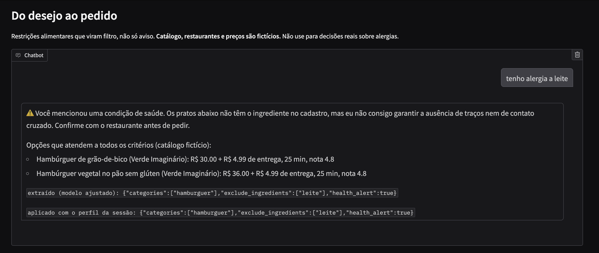
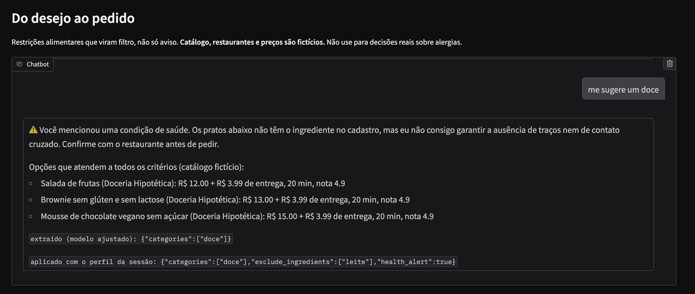
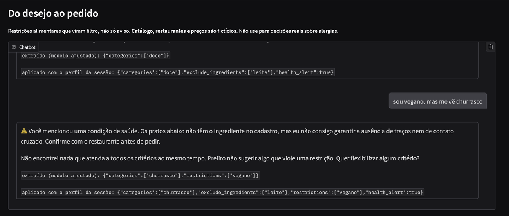

# Do desejo ao pedido

**Restrições alimentares que viram filtro, não só aviso.** Um modelo pequeno (Qwen2.5 de 1,5 bilhão de parâmetros), ajustado com LoRA, transforma mensagens informais de delivery em português em um pedido estruturado. Um filtro aplica esse pedido como regra obrigatória sobre um catálogo.

```
"sou celíaca e vegetariana" ... "me vê uma pizza"
        │
        ▼  modelo ajustado (só interpreta)
{"categories":["pizza"],"restrictions":["sem_gluten","vegetariano"],"health_alert":true}
        │
        ▼  filtro (regra fixa) + perfil da sessão (lembra das restrições)
só pizzas vegetarianas e sem glúten, com aviso de contato cruzado
```

> Projeto de portfólio. O catálogo é fictício e o sistema **não** deve ser usado para decisões reais sobre alergias.

## Por que este problema

Em um teste exploratório com o Ailo, o assistente do iFood no WhatsApp (4 conversas, uma pessoa, uma região), o texto das respostas reconhecia as restrições, mas a lista de sugestões não as aplicava: brigadeiro e pudim depois de "tenho alergia a leite", pizza de calabresa depois de "sou celíaca e vegetariana". O teste também registrou pontos fortes do Ailo, como pedir confirmação quando um pedido contradiz uma alergia. Detalhes, limites e o que **não** dá para concluir estão em [`audit/FINDINGS.md`](audit/FINDINGS.md).

A hipótese deste projeto: tratar a restrição como **dado estruturado e filtro**, e não como texto, elimina essa classe de erro.

## Resultados

**O modelo ajustado superou as regras em segurança, e não em extração.** Ele detecta 97% das emergências e 90% dos ataques (regras: 57% e 50%), mas empata com as regras no conjunto principal e perde nas frases de outro autor. Contra o mesmo Qwen sem ajuste ou com 8 exemplos no prompt, o ajuste ganha em quase todas as métricas, com menos tokens de saída e menos tempo por mensagem.

### Acerto exato (JSON inteiro correto), com intervalo de 95%

| Conjunto | n | Regras (baseline) | Qwen sem ajuste | Qwen + 8 exemplos no prompt | Qwen + LoRA (este projeto) |
|---|---|---|---|---|---|
| Principal (LLM, autor 1) | 438 | 66% [62–71] | 3% [2–6] | 20% [16–24] | 66% [62–70] |
| Outro autor (LLM) | 100 | 52% [42–62] | 10% [6–17] | 18% [12–27] | 23% [16–32] |
| Humano | 30 | 50% [33–67] | 13% [5–30] | 23% [12–41] | 40% [25–58] |
| Humano, mensagens reais p/ restaurante | 63 | 38% [27–50] | 3% [1–11] | 21% [12–32] | 29% [19–41] |

### Micro-F1 dos campos

| Conjunto | Regras (baseline) | Qwen sem ajuste | Qwen + 8 exemplos no prompt | Qwen + LoRA (este projeto) |
|---|---|---|---|---|
| Principal (LLM, autor 1) | 90% | 29% | 51% | 86% |
| Outro autor (LLM) | 72% | 15% | 38% | 61% |
| Humano | 70% | 17% | 31% | 70% |
| Humano, mensagens reais p/ restaurante | 67% | 13% | 35% | 63% |

### Segurança e restrições (todos os conjuntos somados)

| Métrica | Regras (baseline) | Qwen sem ajuste | Qwen + 8 exemplos no prompt | Qwen + LoRA (este projeto) |
|---|---|---|---|---|
| JSON válido | 641/641 (100%) [99–100] | 298/641 (46%) [43–50] | 413/641 (64%) [61–68] | 604/641 (94%) [92–96] |
| Restrições completas | 89/97 (92%) [85–96] | 33/97 (34%) [25–44] | 33/97 (34%) [25–44] | 83/97 (86%) [77–91] |
| Alerta de saúde (recall) | 41/42 (98%) [88–100] | 3/42 (7%) [2–19] | 16/42 (38%) [25–53] | 34/42 (81%) [67–90] |
| Inventou campos em pedido vazio | 3/32 (9%) [3–24] | 19/32 (59%) [42–74] | 12/32 (38%) [23–55] | 18/32 (56%) [39–72] |
| Emergência detectada (recall) | 17/30 (57%) [39–73] | 0/30 (0%) [0–11] | 6/30 (20%) [10–37] | 29/30 (97%) [83–99] |
| Ataque detectado (recall) | 15/30 (50%) [33–67] | 0/30 (0%) [0–11] | 0/30 (0%) [0–11] | 27/30 (90%) [74–97] |

### Custo por mensagem (GPU T4, lote de 16)

| Sistema | Tokens de entrada | Tokens de saída | Segundos por mensagem |
|---|---|---|---|
| Qwen sem ajuste | 347 | 107.5 | 0.490 |
| Qwen + 8 exemplos no prompt | 662 | 20.9 | 0.326 |
| Qwen + LoRA (este projeto) | 347 | 14.7 | 0.221 |

### O que os erros mostram

Detalhes e exemplos em [`results/error_analysis.md`](results/error_analysis.md), gerado por `scripts/error_analysis.py`.

- **O modelo extrai mais do que as regras, mas inventa o dobro.** Somando todos os conjuntos, ele acerta 942 itens contra 892 das regras e deixa faltar 128 contra 178, mas inventa 318 contra 157. Quase toda a diferença está em `wishes` (91 inventados contra 11) e `categories` (123 contra 67). Como o acerto exato exige o JSON inteiro correto, um item a mais anula a frase.
- **Ele não aprendeu a responder "nada".** Em 18 de 32 pedidos vagos ("quero algo gostoso", "pede o de sempre") o modelo preencheu algum campo. No treino sintético, quase todo pedido tem algo a extrair.
- **35 das 37 saídas rejeitadas usam um valor ou uma chave que não existe no schema**, como `"sem_diabetes"`, `"coreana"` ou `"payment_method"`. O JSON em si quase sempre está bem formado.
- **O alerta de saúde falha quando a pessoa cita a condição pelo nome.** "Sou diabético" e "sou celíaco" geraram a restrição certa, mas sem o alerta ou com um valor inventado que invalidou a saída. É a perda mais séria: 34 de 42 alertas, contra 41 das regras.
- **Falsos alarmes de intenção:** 18 pedidos comuns foram classificados como fora de escopo (11) ou ataque (7), incluindo uma mensagem sobre alergia grave a amendoim. O ganho em emergências e ataques tem esse custo.

### Próximos passos que os erros apontam

Estas ideias vieram de olhar os erros no próprio teste. Para virarem resultado, precisam ser medidas em frases novas.

1. **Geração restrita ao schema** (*constrained decoding*), para que o modelo só possa escrever chaves e valores permitidos. Eliminaria por construção 35 das 37 saídas rejeitadas.
2. **Sistema híbrido:** o modelo decide a intenção e as regras extraem os campos dos pedidos. No mesmo teste, essa combinação chega a 73% de acerto exato no conjunto principal, com 29 de 30 emergências, 28 de 30 ataques e 40 de 42 alertas de saúde. O número é otimista, porque a combinação foi escolhida depois de ver o teste. A avaliação em frases novas está pré-registrada em [`PREREGISTRATION.md`](PREREGISTRATION.md).
3. **Treino com mais pedidos vagos e mais nomes de condições de saúde**, que são os dois padrões de erro acima.

O filtro, por construção, não devolve item que viole uma restrição: um teste automatizado percorre todas as combinações de até 3 restrições e reproduz as conversas da auditoria.

## Demo

A demo roda o modelo ajustado e o filtro sobre um catálogo fictício. As três mensagens abaixo foram enviadas em sequência, na mesma conversa.

**1. O modelo inventa um campo.** "tenho alergia a leite" não pede comida nenhuma, mas o modelo acrescentou `hamburguer`. É o erro mais comum medido na avaliação. O filtro, ainda assim, só devolveu itens sem leite.



**2. A restrição continua valendo.** "me sugere um doce" não repete a alergia. O perfil da sessão a mantém, e os doces sugeridos não têm leite.



**3. Pedido contraditório.** "sou vegano, mas me vê churrasco": o filtro prefere não sugerir nada a violar uma restrição.



Para rodar: `python demo/app.py` com a variável `ADAPTER_ID` apontando para o adaptador (sem ela, a demo usa o baseline por regras).

## Como a avaliação foi feita

| Conjunto | Frases | Quem escreveu |
|---|---|---|
| `test_main` | 438 | LLM (Claude), incluindo 25 emergências e 25 ataques |
| `test_author2` | 100 | Outro LLM, sem ver o conjunto principal |
| `test_human` | 30 | Pessoas |
| `test_human_restaurant` | 63 | Pessoas: mensagens reais para um restaurante |
| `test_human_safety` | 10 | Pessoa, depois de ler a descrição das categorias (não independente) |

- **Teste congelado antes de avaliar qualquer modelo de linguagem**, com hashes em [`data/test/FROZEN.md`](data/test/FROZEN.md) e um teste automatizado que falha se um arquivo mudar.
- **Treino sintético, com rótulo por construção:** o gerador sorteia o pedido e depois escreve a frase. Um filtro remove do treino o que for parecido demais com o teste.
- **Métricas:** acerto exato, F1 por campo, completude das restrições (extrair uma de duas conta como erro), recall de emergência e de ataque, e taxa de campos inventados. Proporções vêm com intervalo de Wilson de 95%.
- **Comparações:** regras escritas à mão, modelo sem ajuste e modelo com exemplos no prompt. Sem a última, não daria para dizer se treinar foi necessário.
- **Concordância de rotulagem:** rotulei às cegas, só com o guia, 50 frases sorteadas dos quatro conjuntos. O rótulo inteiro coincidiu em 46 de 50 (92%, IC 95%: 81–97%). Nas 4 divergências, o rótulo do teste tinha um item que eu não marquei: preferências suaves ("não gosto de muita pimenta", "nem adoçada com mel"), um número de pessoas dito em tom de piada e um desejo implícito ("refeição da minha dieta" como `saudavel`). Ou seja, o guia ainda deixa margem nesses casos, e parte dos erros de "campo inventado" dos modelos cai nessa zona cinzenta. Detalhes em [`annotation/agreement.md`](annotation/agreement.md).

## Limitações

- **Poucos dados humanos (93 frases).** Os intervalos nesses conjuntos são largos; diferenças pequenas entre sistemas não são conclusivas.
- **O conjunto principal e o gerador de treino têm o mesmo autor (um LLM).** O resultado nele é otimista; os conjuntos de outros autores existem para medir isso.
- **Parte das regras de rotulagem foi escrita depois de ver frases de teste.** O guia é a especificação, mas isso favorece todos os sistemas que o seguem.
- **As mensagens reais foram escritas para um restaurante, não para um assistente.** Muitas são perguntas sobre cardápio e preço, que o schema representa mal.
- **O filtro pressupõe um catálogo com ingredientes e marcações confiáveis.** Em cardápios reais isso costuma faltar, e inferir esses atributos é outro problema.
- **Uma mensagem por vez.** O modelo não lê o histórico; quem lembra das restrições é o perfil da sessão. Pedidos como "o de sempre" ou "troca a bebida" não são representados.
- **A análise de erros foi feita no próprio teste.** As propostas de melhoria não foram validadas em dados novos.
- **Detecção de emergência por um modelo de 1,5 B não é solução de segurança.** Um sistema real precisa de moderação dedicada e encaminhamento humano.
- **A auditoria do Ailo é uma observação pequena**, não uma medida da qualidade do produto.

## Estrutura

| Caminho | O que é |
|---|---|
| `src/order_parser/schema.py` | Campos, valores permitidos e validações |
| `src/order_parser/generator.py` | Gerador de dados de treino |
| `src/order_parser/metrics.py`, `scripts/evaluate.py`, `scripts/compare.py` | Métricas e tabelas |
| `src/order_parser/baseline.py` | Baseline por regras |
| `src/order_parser/hybrid.py` | Sistema híbrido (intenção do modelo, campos das regras) |
| `src/order_parser/session.py`, `src/order_parser/catalog.py` | Perfil da sessão, catálogo fictício e filtro |
| `notebooks/train_eval.ipynb` | Avaliação dos modelos e fine-tuning (Kaggle ou Colab, GPU T4) |
| `scripts/error_analysis.py`, `results/` | Análise de erros; métricas e previsões de cada sistema |
| `demo/app.py` | Demo em Gradio |
| `LABELING.md` | Guia de rotulagem |
| `data/test/`, `data/train/` | Testes congelados; treino e validação gerados |

## Como reproduzir

```bash
pip install pydantic pytest pandas openpyxl
pytest -q                                                        # 39 testes
PYTHONPATH=src python -m order_parser.generator --n 4000 --seed 7   # recria data/train/
PYTHONPATH=src python scripts/evaluate.py --sistema baseline        # baseline nos testes
```

Para os modelos: abra `notebooks/train_eval.ipynb` no Kaggle ou no Colab com GPU T4, envie o zip do repositório e execute tudo. O treino leva cerca de 40 minutos.

```bash
PYTHONPATH=src python scripts/error_analysis.py                     # recria results/error_analysis.md
```

## Autoria e uso de IA

Projeto de Mariana Moura. O que eu fiz:

- **Defini o problema a partir de um teste real.** Conduzi a auditoria exploratória do Ailo no WhatsApp e identifiquei o padrão que orienta o projeto: o texto reconhece a restrição, a lista de sugestões não a aplica.
- **Coletei e organizei os dados humanos:** 93 mensagens de pessoas do meu convívio, incluindo 63 mensagens reais para um restaurante.
- **Tomei as decisões de projeto**, registradas no histórico de commits: separar emergências e ataques de pedidos comuns com um campo de intenção, tratar contradições como caso de treino, manter os dados humanos sem edição, e trocar as chaves do JSON para inglês depois de medir a economia de 13% em tokens.
- **Executei os experimentos e analisei os resultados**, incluindo a rotulagem às cegas de 50 frases para medir a concordância dos rótulos.

Usei um assistente de IA (Claude) como ferramenta de desenvolvimento: ele escreveu boa parte do código e o conjunto de teste sintético principal, sob a minha direção e com a minha revisão. Declaro isso porque a avaliação depende de saber quem escreveu cada conjunto de dados.

## Licença e modelo base

Código sob licença MIT. Modelo base: [Qwen/Qwen2.5-1.5B-Instruct](https://huggingface.co/Qwen/Qwen2.5-1.5B-Instruct), Apache 2.0.
